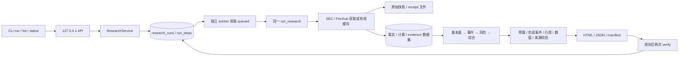

# M3：终端任务、API 与后台 worker

范围沿用原模块：CLI + 本机 API + PostgreSQL 队列 / 历史 + 本地 HTML / JSON。没有增加前端或 PPT 输出。模型仍用本机已经选择的 ChatGPT 订阅授权；这不是 Plus 专属 API key，也不会自动切换到独立计费 API。

## 启动和日常使用

在 WSL 原项目目录，使用已有 `.venv/bin/python`：

```bash
.venv/bin/python aeternitas.py db-init
.venv/bin/python scripts/local_app.py start
.venv/bin/python aeternitas.py run AAPL --wait --wait-seconds 600 --deadline 480
.venv/bin/python aeternitas.py list
.venv/bin/python aeternitas.py status RUN_ID
.venv/bin/python aeternitas.py report RUN_ID
.venv/bin/python aeternitas.py evidence RUN_ID
.venv/bin/python aeternitas.py evidence RUN_ID EVIDENCE_ID
.venv/bin/python aeternitas.py verify RUN_ID
```

不加 `--wait` 会在入队后立即返回 JSON 和 run ID；`wait RUN_ID --seconds 600` 可随后等待。等待超时或 Ctrl+C 只结束 CLI 等待，任务仍保留在后台。创建成功返回排队状态，不代表研究完成。`status`、`wait` 查询到 failed / interrupted 时退出 1；成功退出 0；命令用法错误退出 2，中断退出 130。

`list --company MSFT --status completed --limit 20 --offset 0` 查询数据库历史。当前正式配置只包含 AAPL / MSFT；未知公司明确拒绝。其他公司的 CIK / 别名及适用性需单独配置与验证。

`report` 会核验保存报告的 manifest、来源、计算与引用，并输出浏览器可开的 localhost HTML / JSON 地址。Windows 不应把 `/home/...` 当作 `C:/home/...` 打开。API 运行期间使用 `http://127.0.0.1:8767/research-runs/RUN_ID/report.html`；永久文件仍保存在 `data/live/runs/RUN_ID/`。文件报告中的引用详情可展开查看。

```bash
.venv/bin/python scripts/local_app.py status
.venv/bin/python scripts/local_app.py restart
.venv/bin/python scripts/local_app.py stop
```

这个辅助脚本只管理本项目启动的两个进程，并核对 PID 对应的命令。日志在忽略目录 `data/live/m3/runtime/`。它不是系统开机服务；重启 WSL 后需重新 start。也可以在两个终端分别运行 `aeternitas.py serve` 和 `aeternitas.py worker`。`worker --once` 最多领取一个任务，便于诊断。

新 `run/list/status/report/evidence/wait` 均通过本机 API。`collect`、`data-*` 是 M2 数据工具；`verify/replay` 是保存产物的离线审计 / 回放。显式 `run-local` 保留原同步流程供诊断，会调用配置模型；API 断开时不会自动退回同步研究。旧 M1/M2 文件报告未改写、未自动回填成 M3 任务；可继续 verify / replay 和使用已有预览。

## 实际调用图和存储边界



API 的 POST 只校验并写入 queued，返回 HTTP 202 / Location；不在请求中获取数据或调用模型。worker 领取提交后，依次采集、原子导入数据集、运行四角色、发布和复核报告。每次模型尝试先写入 DB 计数，再发请求；两次 / 角色、八次总调用、deadline 和 SSE 完成事件校验继续有效。未确认的中断请求可能消耗额度，不假定没有收费。

repository 只写 SQL；service 管连接，repository 的每次变更拥有短事务。队列使用参数化 SQL 和 `FOR UPDATE SKIP LOCKED`，领取后立即提交。来源 / 模型等待期间没有打开的 SQL 事务。worker 另持一个 autocommit 连接上的 session advisory lock，限制本机数据库为一个 worker，防止另一个 worker 将活跃任务误判为中断。

`state.json`、步骤输入 / 输出仍保留，DB 保存任务、步骤、dataset_id、模型 / 计费模式、尝试数、usage 和错误。完成状态仅在文件发布及 saved_report 复核后提交。DB 与文件并非原子事务；损坏 / 缺文件会返回 report_integrity_failed，不交付半份报告。

停止 worker 会使当前任务 interrupted；崩溃后下次启动也只标记遗留 running 为 interrupted，queued 仍可领取，历史不会丢失。**M3 不自动重试 / 恢复 / 复用步骤，不提供取消接口或幂等键**；这些属于 M5。重复 run 会创建新任务并可能再次消耗订阅额度。

## HTTP 契约与权限

| 方法 / 路径 | 结果 |
|---|---|
| `POST /research-runs` | 202，持久化 queued，含 run_id、状态和相对查询链接 |
| `GET /research-runs?ticker=AAPL&status=completed&limit=50&offset=0` | 200，items；合法无结果为 `[]` |
| `GET /research-runs/{id}` | 200，当前步骤、错误、模型消耗、已记录步骤 |
| `GET /research-runs/{id}/report.html` | 200，经过核验的 HTML |
| `GET /research-runs/{id}/report.json` | 200，经过核验的结构化报告 |
| `GET /research-runs/{id}/evidence` | 200，该任务数据集全部保存证据 |
| `GET /research-runs/{id}/evidence/{evidence_id}` | 200，该任务内指定证据；ID 须做 URL 编码 |
| `GET /health` | 200，DB / 任务表可查询；不代表 worker 活着或供应商可用 |

POST 字段：`ticker`、`as_of_date`（YYYY-MM-DD）、`question`（1–1200 字），可选 `refresh`（布尔，默认 false）、`news_days`（1–30，默认 14）、`deadline`（1–1800 秒，默认 300）。额外字段、字符串代替布尔 / 整数、未来日期和超过 8 KB 的请求会被拒绝。请求不能指定凭据、任意路径、URL、provider 或 model。

| 状态码 | 错误含义 |
|---|---|
| 400 | 未知公司 / 无效 run ID |
| 401 | 缺少 / 错误本机令牌 |
| 403 | 非 loopback、外部 Host、Origin 或跨站请求 |
| 404 | run / 该数据集 evidence 不存在 |
| 409 | 报告或证据尚未就绪，或报告完整性失效 |
| 413 / 415 / 422 | 请求太大 / 非 JSON / 字段、类型、范围不合法 |
| 503 | 数据库不可用；不会绕过 DB 继续运行 |

默认只监听 127.0.0.1:8767，禁用代理头信任和 access log，无 CORS。API 验证 loopback 客户端与 Host，拒绝浏览器 Origin / cross-site 请求。写操作和任务 / 证据读取使用 `X-Aeternitas-Token`；令牌保存在 `~/.config/aeternitas/local-api-token`（600），CLI 自动读取，不在命令参数、URL、响应或日志里输出。HTML / JSON 报告与 health 允许无令牌本机 GET，方便本机浏览器阅读；这不是多用户隔离服务。外部发布或远程监听不在本模块范围。

CLI 本机 HTTP 客户端 `trust_env=False`，不走代理；worker 保留原供应商代理配置，启动脚本补齐 localhost / 127.0.0.1 / ::1 的 NO_PROXY。供应商 key / 授权状态始终只由程序读取。报告设置 CSP / nosniff / no-store，外部文本 HTML 转义，报告 ID 和文件路径受限。

## 验证记录

运行受控回归（供应商响应为合成数据）及独立真实 PostgreSQL schema：

```bash
AETERNITAS_TEST_DATABASE='dbname=aeternitas host=/var/run/postgresql' \
  .venv/bin/python -m pytest -q
```

`test_m3_application.py` 覆盖即时入队、同一四角色 pipeline、DB 步骤 / 尝试预提交、重建 API 查询、共享规则跨 CLI / API 生效、报告篡改拒绝、SQL 注入文本、空 / 未知 / 404 / 503、写令牌、Host / Origin、请求限制和中断不重放。每个 DB 测试只创建和删除自己的临时 schema，不清空正式数据。

真实 HTTP / 模型 / 进程重启的结果另记 `data/live/m3/acceptance.json` 和同一份 Progress；模拟供应商测试不能替代真实研究成功。当前范围不代表 M4 分析质量、M5 恢复、M7 部署 / 备份或完整 v1 发布完成。

实现参考：[FastAPI 中间件](https://fastapi.tiangolo.com/advanced/middleware/)、[PostgreSQL SELECT / SKIP LOCKED](https://www.postgresql.org/docs/18/sql-select.html)。
